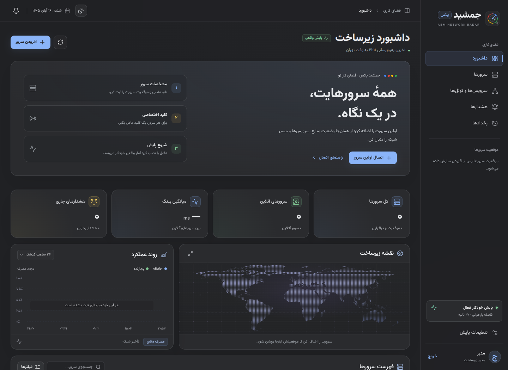

> نسخهٔ 1.2: [نصب مستقیم از GitHub، دامنه و Web Path](guides/webpath-fa.md)

<p align="center"></p>
<h1 align="center">جمشید پلاس · Jamshid Plus</h1>
<p align="center">ABM Network Radar — مرکز پایش فارسی و خودمیزبان زیرساخت</p>
<p align="center"><b>Charcoal / Ivory · Glass UI · Vazirmatn · Linux ARM64 / x86-64</b></p>

<div dir="rtl">

از یک پنل، سرورهای خودت را پایش کن: CPU، حافظه، پورت‌های محلی، سرویس‌های VPN، تونل‌ها و تست شبکه از مبدأ منتخب. پنل با **فهرست خالی** شروع می‌شود. هر سرور پس از نصب عامل اختصاصی، دادهٔ واقعی می‌فرستد.

<p align="center"></p>

| بخش | اجرا و منبع |
|---|---|
| پنل مرکزی | روی یک VPS لینوکسی؛ داده‌ها در SQLite و ورود با حساب مدیر |
| عامل هر سرور | روی همان میزبان؛ خواندن منابع و اجرای تست‌های محدود شبکه |
| صفحهٔ معرفی | GitHub Pages از پوشهٔ docs؛ معرفی، تصویر محیط و راه‌اندازی |

## نصب پنل مرکزی

به **Python 3.10 یا بالاتر، SQLite، scrypt و systemd** نیاز داری. Ubuntu 24.04 گزینهٔ هدف است. فایل‌های ساخته‌شدهٔ رابط، وزیرمتن و Waitress داخل بسته‌اند؛ برای نصب پنل Node.js یا Docker لازم نیست.

ZIP را روی VPS مرکزی استخراج کن و از پوشهٔ پروژه اجرا کن:

</div>

```bash
unzip jamshid-plus-github-ready-v1.2.0.zip
cd jamshid-plus
sudo bash install.sh
```

<div dir="rtl">

نصب‌کننده نام کاربری و گذرواژهٔ مدیر را می‌پرسد. پنل در نصب تازه روی **127.0.0.1:8788** اجرا می‌شود. برای پورت دیگر: `sudo bash install.sh --port 8790`. پورت تنظیم‌شدهٔ نصب قبلی حفظ می‌شود.

در **ترمینال مک یا کامپیوتر خودت**، USER و PANEL_IP را با حساب SSH و نشانی واقعی VPS مرکزی عوض کن:

</div>

```bash
ssh -NT -o ExitOnForwardFailure=yes -o ServerAliveInterval=30 \
  -L 127.0.0.1:8788:127.0.0.1:8788 USER@PANEL_IP
```

<div dir="rtl">

با بازماندن این نشست، [http://127.0.0.1:8788](http://127.0.0.1:8788) را باز کن و وارد شو. برای SSH با پورت سفارشی، `-p SSH_PORT` را اضافه کن. اگر هنگام نصب پورت را تغییر داده‌ای، مقصد فرمان SSH باید همان پورت باشد. این روش با 3x-ui روی ۴۴۳ هم‌زمان کار می‌کند.

## وصل‌کردن سرورهای خودت

1. **افزودن سرور** را بزن و نام، IP یا دامنهٔ واقعی، کشور و گروه را ثبت کن. دامنه‌ها، پورت‌ها و سرویس‌های مورد نیاز را هم می‌توانی اضافه کنی.
2. در صفحهٔ همان سرور، از **اتصال عامل لینوکس ← دریافت کلید نصب عامل ← صدور کلید عامل**، کلید را بگیر. کلید فقط همان بار نمایش داده می‌شود.
3. پروژه را روی **همان میزبان مورد پایش** دریافت و استخراج کن؛ از پوشهٔ آن اجرا کن:

</div>

```bash
sudo bash install-agent.sh
```

<div dir="rtl">

4. نشانی پنل و کلید **همین سرور** را در نصب‌کننده وارد کن.

| محل عامل | نشانی پنل برای نصب‌کننده |
|---|---|
| روی خود VPS مرکزی با پورت پیش‌فرض | http://127.0.0.1:8788 |
| روی سرور دیگر، از طریق تونل SSH | انتهای محلی تونل روی **همان سرور عامل** |
| روی سرور دیگر، از طریق دامنه | آدرس HTTPS و پورت آزاد پنل |

عامل را برای هر سرور با کلید جداگانه نصب کن. پنل مرکزی فقط یک بار نصب می‌شود. نخستین نمونه معمولاً ظرف ۳۰ ثانیه می‌رسد. تا آن زمان «در انتظار عامل» نشان داده می‌شود؛ بیش از ۱۲۰ ثانیه بی‌خبری از عامل قبلاً متصل‌شده، وضعیت را آفلاین می‌کند. ثبت IP به‌تنهایی آمار منابع ایجاد نمی‌کند.

**[اتصال چند سرور، HTTPS، تنظیم 3x-ui / WireGuard / Outline و عیب‌یابی](guides/operations-fa.md)**

## قابلیت‌ها

- داشبورد فارسی RTL، فونت وزیرمتن محلی، پوستهٔ زغالی و استخوانی، تبعیت از سیستم.
- افزودن، ویرایش و حذف میزبان؛ گروه، کشور، دامنه، پورت، سرویس و مقصد تونل.
- کلید مجزای هر عامل، نمایش یک‌بارهٔ کلید، جایگزینی کلید و ابطال با حذف سرور.
- دریافت واقعی CPU / RAM از /proc، آخرین گزارش، پورت‌های محلی و وضعیت شاهدهای سرویس.
- نقشهٔ موقعیت‌های ثبت‌شده و ارتباط تونل‌های پیکربندی‌شده.
- نمودار نمونه‌های واقعی در بازهٔ ۶ ساعت، ۲۴ ساعت و ۷ روز؛ فاصله‌های بدون داده خالی‌اند.
- پینگ، DNS، TCP، UDP و traceroute از عامل انتخابی؛ نتایج در تاریخچه می‌مانند.
- هشدار قطع عامل، مصرف منابع، تغییر سرویس و تست ناموفق؛ پیگیری دستی هشدار.
- چک‌لیست عیب‌یابی، رخداد، یادداشت و پشتیبان‌گیری SQLite.
- عامل و پنل Python بدون وابستگی باینری اختصاصی x86؛ مناسب ARM64 و x86-64.

### تفسیر وضعیت‌ها

شنود پورت محلی، دسترسی آن از اینترنت را ثابت نمی‌کند؛ برای بررسی مسیر از عامل دیگری تست بگیر. وضعیت WireGuard در این نسخه بر پایهٔ رابط یا واحد سرویس است؛ عبور ترافیک را با تست داخل تونل بررسی کن. سکوت UDP «نامشخص» است. برای Outline کانتینری یا سرویس سفارشی، شاهد unit / interface / listen را در تنظیمات عامل تعیین کن. ابزارهای ping و traceroute در صورت نیاز جدا نصب می‌شوند.

## مدیریت

</div>

```bash
sudo jamshidctl status
sudo jamshidctl logs
sudo jamshidctl set-admin
sudo jamshidctl backup
```

<div dir="rtl">

`radarctl` هم برای نصب‌های قبلی حفظ شده است. داده و مسیر سرویس‌های قبلی تغییر نکرده‌اند:
`/etc/radar-infra/panel.env`، `/var/lib/radar-infra` و `radar-infra.service`.
نسخهٔ جدید را از پوشهٔ تازه با `sudo bash install.sh` نصب کن؛ قبل از ارتقا پشتیبان بگیر. کلید عامل در `/etc/radar-agent/config.json` می‌ماند.

## مخزن و صفحهٔ GitHub

نام پیشنهادی مخزن **jamshid-plus** است. [راهنمای آمادهٔ انتشار از مک](GITHUB-SETUP.md) شامل ساخت مخزن، push، Pages و Release است. فایل‌های داخل پوشهٔ jamshid-plus باید در ریشهٔ مخزن قرار بگیرند.

برای صفحهٔ معرفی، در **Settings → Pages**، منبع **Deploy from a branch**، شاخهٔ **main** و پوشهٔ **/docs** را انتخاب و Save کن. [راهنمای رسمی GitHub](https://docs.github.com/en/pages/getting-started-with-github-pages/configuring-a-publishing-source-for-your-github-pages-site)

GitHub Pages صفحهٔ معرفی است. اتصال عامل، اطلاعات سرور و حساب مدیر در پنل نصب‌شده روی VPS خودت قرار دارند.

## توسعه و آزمون

</div>

```bash
npm ci
npm run typecheck
npm run build
python3 -m unittest discover -s tests -v
bash -n install.sh install-agent.sh scripts/radarctl
python3 scripts/package.py
```

<div dir="rtl">

آزمون‌ها یک پنل موقت روی حلقهٔ محلی اجرا می‌کنند و ورود، شروع خالی، ثبت سرور، دریافت واقعی عامل لینوکس، تست TCP، جداسازی کلیدها، ابطال کلید، حذف میزبان، تاریخچه و پشتیبان را بررسی می‌کنند. CI همین بررسی‌ها را روی Ubuntu اجرا و ZIP آمادهٔ نصب را می‌سازد.

| مسیر | کاربرد |
|---|---|
| radar/ و run.py | API، حساب مدیر، SQLite، صف تست و هشدارها |
| agent/agent.py | عامل لینوکسی با اتصال خروجی به پنل |
| frontend/ | سورس React / TypeScript و پوستهٔ جمشید |
| docs/ | صفحهٔ معرفی GitHub و فایل‌های آمادهٔ رابط |
| deploy/ | systemd، ورودی پنل و نمونهٔ Nginx روی 10443 |
| guides/ | اتصال چندسروری، HTTPS و نگهداری |
| tests/ | آزمون‌های محلی یکپارچه |
| .github/ | CI و قالب گزارش ایراد |

سورس تازه با مجوز MIT و اجزای ثالث با مجوزهای خودشان عرضه می‌شوند؛ [NOTICE](NOTICE.md) و [licenses](licenses) را ببین.

</div>
